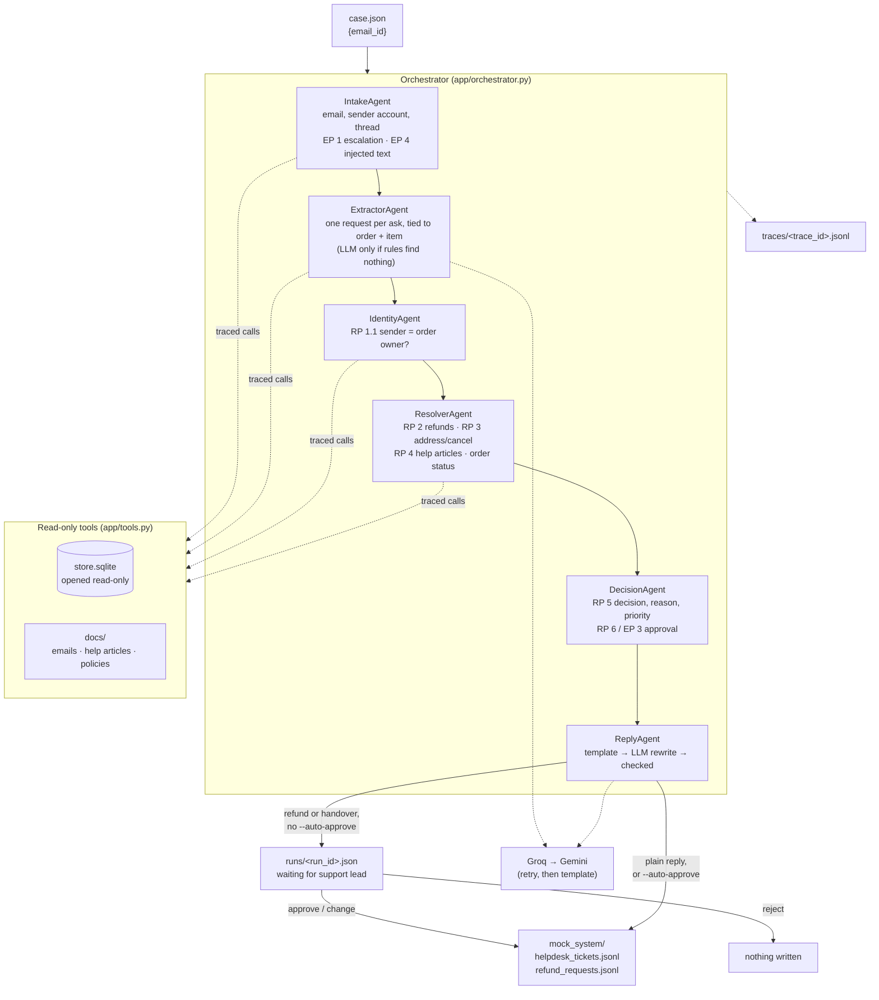

# Architecture

Every agent always runs, because one email can hold several requests. Two short-circuits apply:
an EP 1 trigger hands every request over without answering it, and an RP 1.1 mismatch stops that
order's details from reaching the reply. The LLM never sees raw email text when it writes the reply
(only the template built from checked facts), so instructions inside an email cannot reach it (EP 4).
